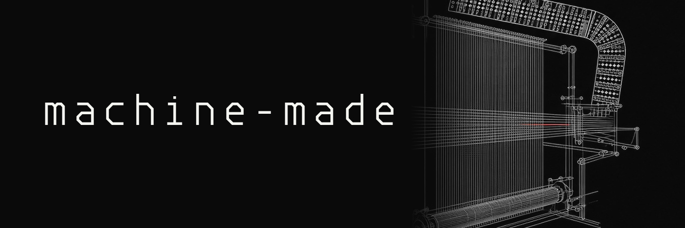

**A home-built, asynchronous factory for scientific software.**

**Type**

- [`type`](https://github.com/machine-made/type): Weft, Sans, Heddle and Warp, typefaces made by code

**Science and numerics**

- [`minuit2-rs`](https://github.com/machine-made/minuit2-rs): CERN ROOT Minuit2 in Rust, checked against ROOT
- [`libsvm-rs`](https://github.com/machine-made/libsvm-rs): LIBSVM in Rust, checked against the C++ original
- [`liblinear-rs`](https://github.com/machine-made/liblinear-rs): LIBLINEAR in Rust, bit for bit with the C original
- [`nebula-quanta`](https://github.com/machine-made/nebula-quanta): deterministic Barnes-Hut N-body simulation
- [`nanochat-rs`](https://github.com/machine-made/nanochat-rs): small language models trained in Rust

**Tools for agents**

- [`alexandria`](https://github.com/machine-made/alexandria): a research library agents search over MCP
- [`bun-do`](https://github.com/machine-made/bun-do): a todo list for people and agents
- [`fortran-lsp`](https://github.com/machine-made/fortran-lsp): Fortran for Claude: compile checks, language server
- [`pi-effort`](https://github.com/machine-made/pi-effort): set the thinking effort of a Pi session
- [`pi-rethread`](https://github.com/machine-made/pi-rethread): hand work to a fresh Pi session
- [`tex2speech`](https://github.com/machine-made/tex2speech): LaTeX and Markdown as spoken words

**Desktop**

- [`pdf-next`](https://github.com/machine-made/pdf-next): a PDF viewer that reloads when the file changes
- [`vscode-pdf-next`](https://github.com/machine-made/vscode-pdf-next): PDF viewing in VS Code
- [`vscode-diff-next`](https://github.com/machine-made/vscode-diff-next): branch and workspace diffs in VS Code
- [`homebrew-tap`](https://github.com/machine-made/homebrew-tap): Homebrew casks for the desktop apps
